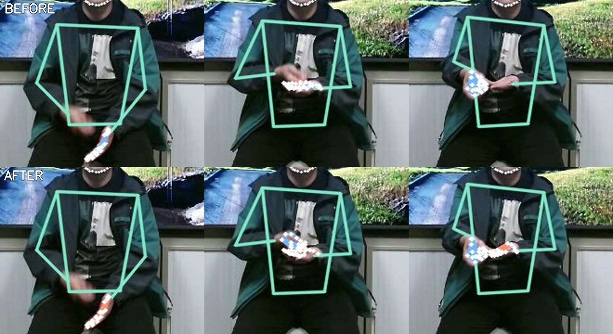
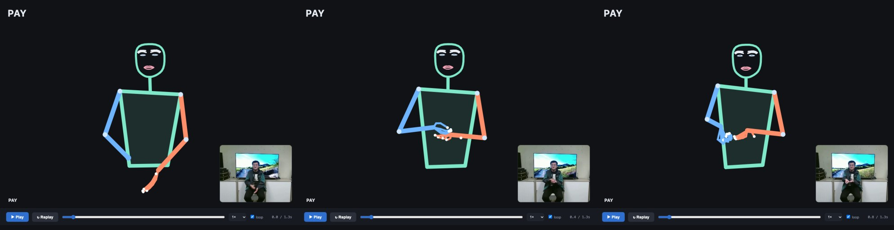
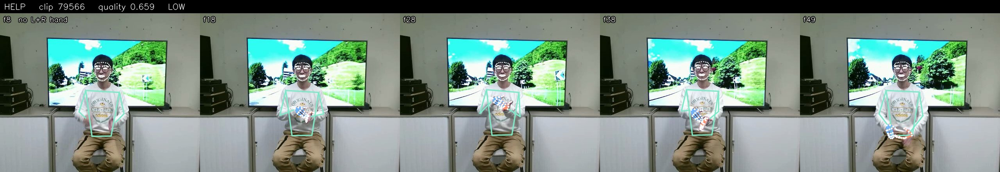

# Animation debugging report: PAY and the wider library

**The problem was in the stored landmark data, not in rendering or
performance.** For half the extracted signs, the extraction had stored a
hand in the wrong arm's slot, or the same hand twice. The player drew
exactly what it was given: one arm ended in nothing, the other's hand
appeared twice. Fixed at the source, then verified sign by sign.

## Symptoms and causes

| what you saw | cause | layer | status |
|---|---|---|---|
| one hand "disappears into the torso", the other "hangs down" | the wrist-crop pass stored the **other** hand in a slot (left/right swap), or **the same hand twice** | extraction | **fixed** (extractor v4) |
| hands not connected to arms, fingers "disconnected" | the swap above; plus the arm drawn to the pose model's wrist while the hand is drawn from the hand model's own wrist | extraction + rendering | **fixed** |
| hands flickering in and out | a hand absent for a few frames: motion blur, or one hand hidden behind the other | source video | **flagged**, not invented (see HELP) |
| jumps at the end of a loop | looping jumped straight from the last frame to the first | playback | **fixed** (wrap transition) |
| stepped motion, especially at 0.5x | each recorded frame (30 fps) held for several display refreshes (60 Hz) | playback | **fixed** (interpolation between the two recorded frames) |
| arm looks "collapsed" when reaching forward | a 2D drawing cannot show depth: an arm pointing at the camera is short on screen (the video looks the same) | inherent to 2D | **not a defect**; the validator ignores shortening and flags only stretching |
| "lag" | not found: script cost is ~2% of one core, with one animation loop | -- | profiled, see below |

## How the cause was found

**1. PAY, frame by frame.** For each stored hand, its wrist point was
compared with both arms' wrists. In 12 frames the "right" hand was nearer
the **left** arm's wrist. In 11 frames the left and right hands were 0.01-0.10
shoulder-widths apart, so the same physical hand was stored twice.

**2. Which pass produced them.** Across the first 506 extracted signs:

| hands produced by | distance from own wrist, 99th percentile | further than 0.35 shoulder-widths |
|---|---|---|
| pass 1, Holistic | 0.24 | 0.5% |
| **pass 2, wrist crop** | **0.83** | **24.7%** |
| pass 3, interpolated | 0.54 | 3.9% |

Pass 2 re-detects a hand in a crop around one wrist, then stores it on
that wrist's side. When the hands are close (PAY, HELP, FRIEND...) the crop
contains **both**, and the detector returned whichever it found. Overall,
**259 of 506 signs (51%)** had wrong-slot or duplicate frames: 2,070
hand-frames in the wrong slot, 1,971 duplicated.

**3. Drawn back over the video.** In the old data at f10, the right-hand
skeleton (blue) sits on the signer's resting **left** hand. At f21 the two
hands are drawn on top of each other, and at f33 the left hand has none:



## What was checked and is NOT a cause

- **Coordinate transforms.** Pose, hands and face pass through one
  similarity transform per clip (tested: all distance ratios preserved).
  Hands are not scaled or offset differently from the body.
- **Left/right mapping in the player.** Pose 15 (left wrist) and
  `left_hand` are consistent throughout. The swaps came from extraction.
- **Timing.** The corpus clips are constant-frame-rate: in 60 random clips
  every frame interval is 1/30 s to within 0.001 ms, so frame-based timing
  *is* timestamp timing. The Signbank letters (12-25 fps) are resampled by
  elapsed time when built.
- **Performance.** One animation loop, a stable listener count, and a
  bounded cache (80 signs). Script time is ~2% of a core. There is no
  React, so no re-render cost.

## Fixes

**Extraction** (`backend/extract_motion.py`, version 4). A hand is only ever
stored in the slot of the arm it is attached to:

- After pass 1, a hand nearer the other arm's wrist is dropped (unless it is
  within 0.15 shoulder-widths of its own -- touching hands, 58 such cases).
  If both slots hold the same hand, the one nearer its own wrist is kept.
- Pass 2 now asks for **two** hands per crop and keeps only one attached to
  the cropped wrist (within 0.35), that is not a copy of the other slot's.
- A dropped slot stays empty unless pass 2 finds the right hand or pass 3
  can bridge a gap of 4 frames or fewer. Nothing is invented.
- Every file records the extractor version; `build_library.py` re-extracts
  anything older automatically. The arms' pose confidence (visibility) is
  now stored too.

**Validation** (`scripts/validate_signs.py`, new). Every sign is checked
when extracted and on demand:

- **Hands:** in the wrong slot, duplicated, or detached from their arm.
- **Tracking:** coverage while signing, dropouts and gaps, jumps (> 0.5
  shoulder-widths in 1/30 s), low pose confidence.
- **Shape and length:** limb stretch (longer than the limb's own 90th
  percentile x 1.3), clips under 0.6 s.

Each sign comes out **ok**, **review** (usable, degraded) or **unreliable**
(wrong data). The status goes into the manifest:

- **Typed sentence.** The planner **fingerspells an unreliable sign by
  default** and keeps it in that word's menu.
- **Quick pick or gloss line.** An explicit choice plays the sign, with the
  flags shown under the gloss.
- **Second takes.** `build_library.py --takes rescue` extracts the second
  take of every flagged sign, and the manifest keeps the better one.

**Playback** (`frontend/`):

- **Joined wrists.** The forearm now ends at the hand's own wrist point when
  the hand is attached, so arm and hand share one wrist.
- **Interpolation.** Between two recorded frames the figure is
  interpolated, so motion is smooth at every speed. A hand present in only
  one of the two frames is taken from the nearer frame, never blended with
  nothing. Each sign's path and timing are unchanged.
- **Loop transition.** Looping passes through a 0.22 s transition instead
  of jumping.
- **Less work.** Text is written only when it changes, the slider moves
  only when visible, and nothing is redrawn while paused.



*PAY after the fix: at f21 and f33 both hands are attached to their own
arms in front of the chest, matching the source video. At f10 the
motion-blurred right hand is an honest wrist dot.*

## Measured results

**The 8 signs** (old extraction -> fixed extraction):

| sign | before | after |
|---|---|---|
| **PAY** | unreliable: 12 wrong-slot, 11 duplicated | **ok** |
| **HELLO** | review: 1 wrong-slot, 1 duplicated | **ok** |
| **THANKS** | review: tracking gap | **ok** (second take, quality 0.97) |
| **HELP** | unreliable: 29 wrong-slot, 34 duplicated | **review**: second take, left hand 66% covered |
| AGAIN, BAD, BILL, DOCTOR | ok | ok |

**The same 111 signs**, old data against fixed, under the same validator rule:

| | ok | review | unreliable | wrong-slot frames | duplicate frames |
|---|---|---|---|---|---|
| old extraction | 48% | 28% | 24% | 383 | 375 |
| **fixed extraction** | **73%** | 23% | **5%** | **0** | 5 |

The 5 remaining duplicate frames are most likely palms pressed together,
which genuinely overlap. The full re-extraction is running (see the end of
this report).

**Playback cost** (Chrome's counters, per second):

| | before | after |
|---|---|---|
| paused: style recalcs / layouts / DOM changes | 60 / 60 / 120 | **0 / 0 / 0** |
| paused: script time | 15.3 ms | **1.8 ms** |
| playing: style recalcs / DOM changes | 60 / 120-240 | **10 / 10-15** |
| playing: script time | 20-22 ms | 15-19 ms |

**Tests:** 30 JS + 12 Python (+1 skipped until clip 20062 is re-extracted)
+ 9 LLM-validation, all passing. New tests cover:

- the ownership rules: wrong slot dropped, duplicate dropped, touching hands kept
- the validator on the **original** buggy PAY data, kept as
  `tests/fixtures/` (flagged unreliable), and on the fixed PAY (clean)
- interpolation, the loop transition, and the planner's handling of
  unreliable and review signs

The browser behaviour test passes, including play, pause/resume, replay,
scrub, speed, loop and video sync.

## Signs that need better source data

Re-extraction cannot fix what the camera did not capture:

- **HELP**: in this sign the right fist rests on the open left palm, so
  the left hand is hidden in both takes. Take 2 is used (66% coverage) and
  plays with a visible "review" flag:

  

- **Generally:** fast movements blur the hands (they show as wrist dots for
  a few frames), and signs where one hand covers the other lose that hand.

The complete list comes from the validator once the run finishes:

```sh
python3 scripts/validate_signs.py              # writes datasets/processed/validation.json
../.venv-1/bin/python scripts/build_library.py --takes rescue   # second takes for flagged signs
python3 scripts/validate_signs.py              # re-check
```

Signs still **unreliable** after the rescue need a better recording. Signs
marked **review** play with their flags visible.

## Status

The full re-extraction with extractor v4 is running in the background
(about 10 signs/min, roughly 5 hours). Signs not yet re-extracted keep
their old data, and the validator marks them, so the planner fingerspells
the unreliable ones meanwhile.
