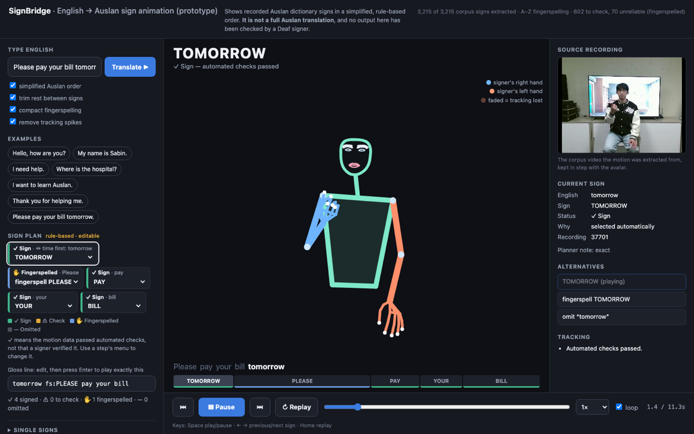

# CDU IT Code Fair 2026: audit, fixes and release check

State on 2026-10-27. Commits `3a338cd`, `fb77139`, `7a4f6a3` and the docs commit
after them. Nothing has been deployed.

**What this is.** A prototype that turns English into a sequence of
*recorded* Auslan dictionary signs and plays them on a 2D figure. It is
not a translator: the order is rule-based, many words are fingerspelled,
and the figure shows no grammatical facial expression. No output has been
checked by a Deaf signer. The page now says this in its header.



## 1. Problems found, causes, fixes

| # | problem (how it was found) | root cause | fix | files |
|---|---|---|---|---|
| 1 | Hands blinked out for a frame or two several times per sentence: 35 abrupt disappearances across 7 test sequences (60 Hz sampling script) | MediaPipe loses a hand briefly; gaps over 4 frames are not interpolated at extraction, and the renderer dropped the hand at once | A hand that loses tracking is drawn **faded** for at most 6 recorded frames (0.2 s), using the nearest measured handshape carried rigidly with the arm's measured wrist. Never reshaped or blended; drawn translucent without fingertip highlights so it reads as "not measured". 35 abrupt drop-outs became 5, and those 5 fade out | `timeline.js`, `index.html` |
| 2 | In a transition, a hand tracked on only one side vanished for the whole gap | `lerpFrame` returns no hand when one side has none | The same faded hold, fading out (or in) across the gap | `timeline.js` |
| 3 | Single-frame landmark spikes (worst: 0.73 shoulder widths) | MediaPipe noise | 3-frame running **median** per coordinate: removes one-frame spikes, passes steady motion through unchanged, and every output value is a measured value. Median change 0.003 shoulder widths (under a pixel). Cost: a genuine one-frame extreme (a tap) is clipped to its neighbour. Switchable on the page ("remove tracking spikes") | `library.js` |
| 4 | "My name is Sabin." took 17.8 s; each letter 1.1–4.4 s | Letter clips are separate recordings with rise, hold and fall | **Compact fingerspelling**: inside a word, play only each letter's held handshape (longest run where both wrists are still, ≤ 0.6 s). Selects measured frames only. 17.8 s → 7.7 s. **H and J keep their whole recording** because they are made with movement; this rule is an assumption for a signer to check. Switchable | `library.js`, `index.html` |
| 5 | The head changed size between signs and letters | Letters have no face landmarks; the fallback circle was 0.72 × nose–neck | 0.49 × nose–neck: the median face-outline radius measured over the library | `index.html` |
| 6 | A fingerspelled word didn't say *why* (a name? no sign? unreliable sign?) | Spell steps carried only free text | Every spell step carries a reason code (`name`, `requested`, `nosign`, `sense`, `loose`, `unreliable`, `pending`), shown in words on the stage, the step's tooltip and the sign panel | `planner.js`, `index.html` |
| 7 | UI: one crowded sidebar; video over the stage; captions overlapping it; no way to jump between signs | — | Three-panel layout (below); step strip; prev/next; keyboard | `index.html` |
| 8 | A new browser test failed only inside the full run | It reused the behaviour test's Chrome debugging port and attached to a browser that was shutting down | Own port (test-harness bug, not an app bug) | `tests/browser/test_controls.py` |
| 9 | The full build (1 GB) cannot go to Vercel | Vercel's CLI upload cap is 100 MB (Hobby) / 1 GB (Pro) | `--signs-from` partial build (74 MB) | `build_dist.py`, `collect_sign_ids.mjs` |
| 10 | Returning to a hidden tab made playback jump ahead | The clock kept running while no frames were drawn | Resume from where it was | `index.html` |

## 2. What was checked and found sound (no change needed)

- **Positions don't jump.** Largest wrist move between 60 Hz refreshes on
  the example sentences: 0.19 shoulder widths inside a sign, 0.13 in a
  transition.
- **One clock.** Figure, captions, step strip and video all follow one
  timeline time. Stale async loads are discarded (`buildSeq`). Rapid
  switching is tested.
- **Consistent camera.** One layout for the whole sentence; every clip
  normalised to shoulder width 1.
- **Library integrity.** `scripts/check_library.py` (new, read-only) checked
  3,215 signs, 26 letters and the quick picks: no missing or unreadable
  file, no frame-count mismatch, no out-of-range coordinate, no duplicate id.
  No clip was regenerated.

## 3. Text-to-Auslan on the demo sentences

| English | plan (simplified order) | notes |
|---|---|---|
| Hello, how are you? | HELLO · YOU · ✋HOW | "are" omitted by the planner; *how* fingerspelled and moved last (wh-question) |
| My name is Sabin. | MY · ✋NAME · ✋SABIN | NAME: only a loose dictionary match (NICKNAME), offered in the menu; Sabin: a name |
| I need help. | I · NEED · ⚠HELP | HELP's tracking is flagged for review |
| Where is the hospital? | ✋HOSPITAL · ✋WHERE | neither word has a sign in this corpus |
| I want to learn Auslan. | I · ✋WANT · LEARN · AUSLAN | |
| Thank you for helping me. | THANK YOU · ✋FOR · ⚠HELP · ME | |
| Please pay your bill tomorrow. | TOMORROW · ✋PLEASE · PAY · YOUR · BILL | time word moved first |

HOW, WHERE, NAME, WANT, PLEASE, FOR and HOSPITAL have **no recording in the
3,215-sign corpus**. Fingerspelling them is correct behaviour for this
library; it is a coverage gap, not a bug. The reordering is a mechanical
rule ("simplified Auslan order"), not Auslan grammar.

States on every step: ✓ Sign (selected automatically / via dictionary /
from a stem / chosen by you; automated tracking checks passed) · ⚠ Check
(ambiguous meaning, or tracking flagged) · ✋ Fingerspelled (with its
reason) · — Omitted. "Verified" is never shown: no step has been verified
by a signer. Manual correction remains via each chip's menu, the new
Alternatives panel, and the gloss line.

## 4. UI redesign

- **Header:** name, the "not a full Auslan translation" statement, library
  status.
- **Left:** English input and Translate, options, example sentences, the
  editable plan with legend, gloss line, notes, quick signs (collapsed).
- **Centre:** current sign and status, the figure with a hand-colour key
  ("signer's right / left hand", "faded = tracking lost"), the English with
  the active word highlighted, and a step strip sized by time (click to
  jump, coloured by state).
- **Right:** source video in sync; sign details (English, sign, status, why,
  recording id, planner note); alternatives as buttons; tracking warnings.
- **Bottom:** previous, play/pause, next, replay, scrubber, speed
  0.5–1.5×, loop, time.
- **Keys:** Space, ← →, Home. They never act while typing in a field.
- **States:** "loading N signs…" (only if loading takes over 150 ms), "Nothing to sign",
  "could not be loaded", and a library-missing message that names the
  command to run.
- **Responsive:** three columns ≥ 1180 px; two columns with a details
  strip below the stage on tablets; one scrolling column on phones, with
  sticky controls. No horizontal scroll at 1440, 1280, 1024 or 390 px wide.
- No new dependency; no heavy animation.

## 5. Tests

`sh tests/run_all.sh 8003`, run on 2026-10-27 after the final change:
**all suites passed** (full run passed twice in a row before the last
additions, then again after them).

| suite | count | result |
|---|---|---|
| Node unit tests | 55 (was 40) | pass |
| library integrity check (new) | 3,215 signs + 26 letters | pass, 0 errors |
| Python pipeline | 16 | pass |
| LLM plan validation (offline) | 9 | pass |
| browser: behaviour | 23 checks | pass |
| browser: robustness | 15 checks | pass |
| browser: controls + end-to-end (new) | 26 checks | pass |

New regression tests (`tests/test_playback.mjs`, `tests/browser/test_controls.py`):
spike removal (removes a spike, keeps motion, never fills a gap, every
value measured, on real clips); held hands (fade, rigid shape, follows the
wrist, ≤ FADE frames, one-sided transitions); timeline boundaries (before 0,
at the end, past loopEnd, empty); a 10-sign real sentence drawable at every
1/60 s; letter cores; demo sentences (every step explained, no unreliable
sign plays, every spelled step has a reason); empty / blank /
punctuation-only input; repeated words; rapid input; the partial-build
collector; and in the browser, a missing library, step strip, prev/next,
keys, alternatives, compact switch, spike switch, nothing-to-sign,
blank input, speed 1.5×, scrub, mobile viewport.

## 6. End-to-end checklist (browser, headless Chrome)

| check | result |
|---|---|
| single sign | **pass** |
| two-sign sequence | **pass** |
| 5+ word sentence | **pass** |
| unknown word (fingerspelled, says no sign exists) | **pass** |
| fingerspelled name (labelled as a name) | **pass** |
| rapid switching (all 7 examples clicked at once) | **pass** |
| pause / resume | **pass** |
| speed (0.5× and 1.5×) | **pass** |
| scrub | **pass** |
| mobile viewport (390 × 844, emulated) | **pass** |
| a real phone, a real Safari | **not verified** |
| a Deaf / Auslan-fluent viewer | **not verified** |

## 7. Performance (MacBook, headless Chrome, served locally)

| measure | value |
|---|---|
| page usable after load | 0.43 s |
| startup download | ~0.9 MB uncompressed (less when the host gzips) |
| each demo sentence ready to play | 0.08–0.32 s |
| download after all 7 demo sentences | 6.9 MB |
| JS heap | ~21 MB |
| playing: frame interval | 16.7 ms median, 16.8 ms p99 (no dropped frames) |
| playing: script time | 25 ms per second (2.5 % of one core) |
| paused | ~0 work (no redraws) |

Measured on this development Mac, not on an M1 Air specifically; the load
is light enough that an M1 Air should not be the limit.

## 8. Deployment status

- `dist/` currently holds the **web demo build** (74 MB, 700 files), tested
  locally with the behaviour and controls suites (all pass, no failed
  requests).
- Full build (1,034 MB) also built and tested (all three browser suites
  pass); it suits Cloudflare Pages or Netlify, not Vercel.
- **Not deployed.** Deploying needs your approval, and before any public
  showing: confirm the corpus licence; 13 letters come from Auslan Signbank
  (CC BY-NC-ND 4.0, non-commercial, attribution required).

## 9. Limitations (say these out loud at the fair)

- Not a translation: dictionary signs in a rule-based order; no
  classifiers, role shift, spatial grammar or non-manual features.
- Vocabulary: 3,215 signs; many everyday words are missing and fingerspelled.
- Tracking: 602 signs flagged for review, 70 unreliable (never played from
  typed text). Faded hands mark moments of lost tracking.
- Fingerspelling letters come from mixed sources; compact mode's H/J rule
  is unverified.
- Nothing has been evaluated with Deaf viewers.

## 10. Run it

```sh
cd auslan-ai-clean
python3 backend/serve.py 8003            # open http://localhost:8003
sh tests/run_all.sh 8003                 # every test (needs Chrome for browser suites)
python3 scripts/check_library.py         # library integrity, read-only

# web demo for hosting (74 MB), then test it
python3 scripts/build_dist.py --signs-from scripts/web_demo.txt --small-videos
python3 backend/serve.py 8005 dist       # open http://localhost:8005
# deploy only after approval: npx vercel deploy dist --prod
```

Links straight to a sentence: `http://localhost:8003/?text=I need help.`
