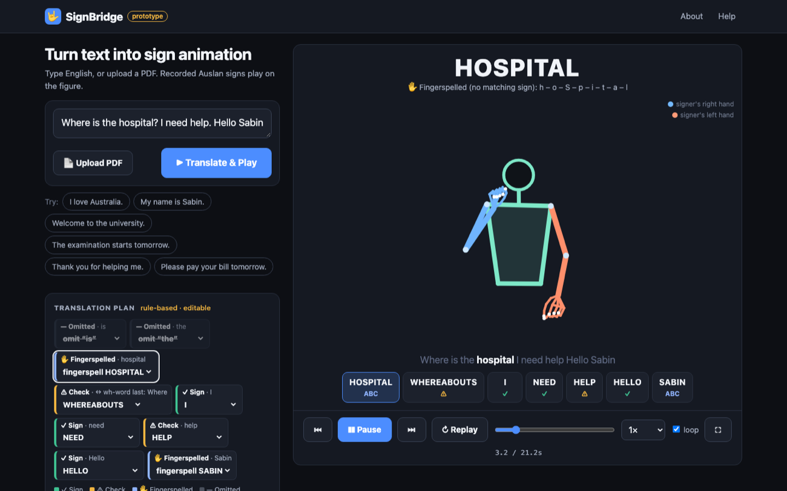

# Implementation summary: audit, UI, avatar, pipeline, playback (27 Oct 2026)

Measured and tested the same day. "Automated tests pass" says nothing about
whether the signing is correct Auslan; nothing here has been checked by a
fluent signer.

## Audit: what was found

| finding | detail |
|---|---|
| **Stack differs from the brief** | SignBridge is plain JavaScript modules (no React, Next.js or TypeScript) and a static site. There are no components to re-render, so the "React re-render" items do not apply. The architecture was kept; a rewrite would have added risk for no gain |
| Rendering engine | 2D `<canvas>`, drawn directly from MediaPipe landmarks (`drawFrame`) |
| Motion format | compact v2 JSON: integers at 1/10,000 of the image; pose (33), hands (21 each), face (128), `x` and `y` only |
| Pipeline | text → `planner.js` → `library.js` (fetch, cache, normalise) → `timeline.js` → canvas, with the playback clock inline in the page |
| **Defect: sentences** | the planner treated all text as one sentence. In "Where is the hospital? I need help." the question flag was lost, and a time word in a later sentence jumped to the front of the whole text |
| **Structure** | drawing (~240 lines) and the playback clock sat inside `index.html` (1,547 lines) with the UI, so neither could be tested alone |
| Performance | already event-light: no redraw while paused, one `requestAnimationFrame` loop, DOM writes only on change, LRU cache. Measured below |
| Unused code | none found: every script, module and test is referenced; experiments and old reports were removed earlier |
| Accessibility gaps | screen readers were not told which sign is playing; no full-screen mode |

## What changed

| area | change |
|---|---|
| **UI** | two columns: left = text, PDF upload, Translate, the editable translation plan, vocabulary lists (signs available · signs to check · no sign so fingerspelled · names · left out by the planner); right = avatar, current gloss, sign tiles, timeline, play/pause/replay, previous/next sign, speed, loop, **full screen** (button or F). The avatar stays in view while the left column scrolls. One column on phones, avatar directly under the input. Advanced settings (gloss editor, source video, alternatives, tracking, options) stay collapsed |
| **Accessibility** | a polite live region announces "Signing LOVE, 2 of 3" (or "Fingerspelling…, best guess"); the scrubber's value text carries the same; keyboard: Space, ← →, Home, F, Tab to every control; the sentence under the figure wraps on narrow screens (it was clipped) |
| **Translation pipeline** | `planner.js` now plans **per sentence** (question flag, wh-word last and time-first stay inside their sentence; "Dr." and "2.0" do not split). Stages are named in the code: normalise → concept mapping → gloss selection → fallback. The planner never touches motion or drawing |
| **Rendering** | `src/renderer.js`: drawing only, no page, no playback state |
| **Playback** | `src/player.js`: the one clock. Play, pause, resume, restart, speed, seek, next/previous sign, loop wrap, stop at the end, idle when paused, and no clock jump after a hidden tab. Tested on a fake clock, including a 1,000-random-action stress run. A bug found by those tests (a paused page would have kept redrawing) was fixed |
| Race conditions | a request counter drops stale loads; a burst of 40 translations leaves only the last on screen and in the video panel (tested) |
| Missing motion file | the sentence still plays and the failed sign is named (tested earlier, still passing) |

index.html: 1,547 → 1385 lines, plus `renderer.js` 240 and `player.js` 150.

## Performance (same measuring script, headless Chrome on this Mac)

| | before | after |
|---|---|---|
| paused: redraws, layouts, style recalcs per second | 0 | 0 |
| paused: script time | 2.1 ms/s | 1.9 ms/s |
| playing: script time | 25.1 ms/s | 15.9 ms/s |
| playing: frame interval median / p99 | 16.7 / 16.8 ms | 16.7 / 16.8 ms |
| playing: style recalcs | 10.8/s | 10.4/s |
| CPU throttled to ¼ speed: clock vs real time | not measured | 0.99× at ~60 fps |
| 60 more sentences: cache / JS heap | not measured | 62 signs (cap 80) / 37 → 42 MB |

The "before" column was measured on the earlier build served from `dist/`;
the "after" on the dev server, so part of the playing-time difference may be
measurement noise.

## Tests (all executed 27 Oct)

88 Node (+15 this round: player 11, sentences 4) · 34 Python · library
integrity (3,215 signs, 26 letters) · 8 browser suites (+ stress / slow device).
The 86 MB demo build also passes six of the browser suites.

New cases: single sign, short and 70-word sentences, unknown word,
fingerspelled name, 40 rapid translations, 101 play/pause clicks, missing
motion file, phone size, CPU throttled to ¼.

One browser test failed once inside a full run and passed in the next
three; the cause was not found. It now prints the playback state when it
fails, to make a recurrence diagnosable.

## Limits of the avatar (reported, not fabricated)

- **No depth.** Motion files hold `x, y` only. Which way a palm faces,
  and hand movement toward or away from the camera, cannot be drawn. Fixing
  it means re-extracting with MediaPipe's z values and a new file format.
- **Hand orientation and handshape** are the 21 hand points as tracked. Where
  tracking is poor (602 signs flagged, 70 unreliable) shapes are
  wrong or missing; held hands are drawn faded for at most 0.2 s.
- **Shoulders and elbows are stable** in the data: shoulder jitter median
  0.0008 and elbow 0.0024 shoulder-widths. Shoulder width varies about 7%
  within a clip because the signer moves toward the camera; the figure
  uses one scale per clip, so that shows as slight scale change, not noise.
- **Left/right** are the signer's; the key on screen says so. The extractor's
  hand-ownership rules removed the swapped and duplicated hands found earlier.
- **Face** is hidden by default (switch in Advanced). Auslan grammar carried by
  eyebrows, mouth and head is not modelled.
- **Not linguistic:** matching English words to recorded signs, with a few
  mechanical ordering rules, is not Auslan grammar.
- **Not done:** `pose_vis` (visibility of arm joints) is stored but not yet
  used to dim uncertain arms.
