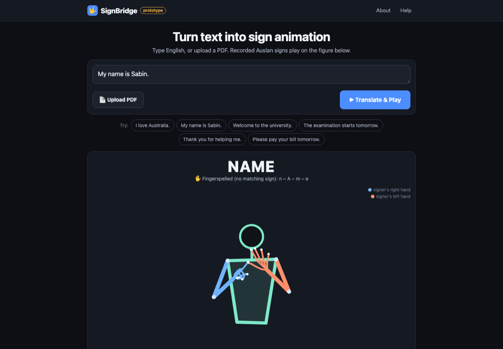

# Matching and interface review (27 Oct 2026)

Measured with `node scripts/matching_report.mjs` on 30 everyday sentences.
Coverage = signed words / (words − names − words the planner omits). It
measures how often an available sign is **used**, not whether the signing is
correct Auslan.

## Result

| | before | after |
|---|---|---|
| meaningful words | 112 | 112 |
| signed | 90 (**80.4 %**) | 94 (**83.9 %**) |
| signed with confidence (not ⚠) | 73.2 % | 74.1 % |
| fingerspelled (not names) | 22 | 18 |
| names fingerspelled | 1 | 1 |
| omitted by the planner | 24 | 24 |

The gain is small on purpose. Most remaining fingerspelling is words this
corpus has **no sign for**; filling those with loosely related signs would
raise the number and make the signing wrong.

## Why NAME is fingerspelled

- No gloss means "name". `Test_ITW.json` has `SIGN-NAME` (an Auslan *sign
  name*, a different concept) and nothing else.
- The dictionary links "name" only to NICKNAME, as its 4th of 6 keywords.
  The planner treats that as too loose to play automatically; NICKNAME is in
  the step's menu (Advanced → Sign plan) for anyone who wants it.
- So this is a vocabulary gap, not a matching bug. SABIN is fingerspelled
  because it is a name.

## Root causes of fingerspelling (all 30 sentences)

| cause | words | what was done |
|---|---|---|
| no sign in the corpus | how, please, want, for, morning, toilet, (exam before) | nothing can be done without new recordings; "exam" now reaches EXAMINATION's sign (a clipped word) |
| only a loose dictionary link | name, hospital, understand, very, darwin | kept fingerspelled: NURSE ≠ hospital, SEE ≠ understand, SORROW ≠ very |
| a related form was rejected as loose | happy (HAPPINESS), where (WHEREABOUTS) | **fixed**: related forms (-ness, -ment, -ation, -ity, -abouts) now play, marked ⚠ |
| sign exists only in another sense | sign (SIGNPOST), call, live | kept: no evidence in the sentence for that sense. "live in" → RESIDENCE was considered and rejected: that sign's dictionary keywords include LADY and WOMAN |
| sign's motion unreliable | friend | kept: unsafe to play (fails tracking checks on both recordings) |
| multi-word labels never matched | COVID 19, THAT'S RIGHT, NONE OF ONE'S BUSINESS, USHER'S SYNDROME | **fixed**: these labels contain digits, contractions or possessives, which the planner rewrote before looking them up |

Not causes: plurals and past tense already worked ("students" → STUDENT,
"helped" → HELP); no available sign was marked unavailable. A sweep of all
2,847 usable plain signs (in `tests/test_matching.mjs`) confirms that typing
a sign's own name plays a sign, apart from A, ARE and TO, which the planner
omits as grammar words by design.

Also changed: the corpus labels its everyday DEAF sign "DEAF MUTE", a dated
term; the screen now says DEAF and Advanced → Current sign shows the corpus
label.

Words the related-form rule deliberately leaves alone because English uses
them in another sense: mean, hard, major, fair, pretty, plain, tight.

## Per sentence (after)

```
sentence                             words meaningful signed ambiguous spelled names omitted  plan
My name is Sabin.                        4          2      1         0       1     1       1   MY fs:NAME (is) fs:SABIN
Hello, how are you?                      4          3      2         0       1     0       1   HELLO (are) YOU fs:HOW
I love Australia.                        3          3      3         0       0     0       0   I LOVE AUSTRALIA
Students must attend classes.            4          4      4         2       0     0       0   STUDENT MUST COMING STYLE
I want to learn Auslan.                  5          4      3         0       1     0       1   I fs:WANT (to) LEARN AUSLAN
Thank you for helping me.                5          5      4         0       1     0       0   THANK YOU fs:FOR HELP ME
Please pay your bill tomorrow.           5          5      4         0       1     0       0   TOMORROW fs:PLEASE PAY YOUR BILL
Where is the hospital?                   4          2      1         1       1     0       2   (is) (the) fs:HOSPITAL WHEREABOUTS
I need help.                             3          3      3         0       0     0       0   I NEED HELP
Welcome to the university.               4          2      2         1       0     0       2   WELCOME (to) (the) MORTARBOARD
I am a student.                          4          2      2         0       0     0       2   I (am) (a) STUDENT
The doctor will see you now.             6          5      5         0       0     0       1   NOW (The) DOCTOR WILL SEE YOU
Can you help me please?                  5          5      4         0       1     0       0   ABLE YOU HELP ME fs:PLEASE
My friend is deaf.                       4          3      2         0       1     0       1   MY fs:FRIEND (is) DEAF
I live in Darwin.                        4          4      2         0       2     0       0   I fs:LIVE IN fs:DARWIN
We go to school every day.               6          6      6         1       0     0       0   WE GO TO SCHOOL EVERY DAYTIME
What time is it?                         4          3      3         0       0     0       1   TIME (is) IT WHAT
I don't understand.                      3          3      2         0       1     0       0   I (don't) NOT fs:UNDERSTAND
The bus is late today.                   5          3      3         1       0     0       2   NOW (The) VAN (is) LATE
Please call me tomorrow morning.         5          5      2         0       3     0       0   TOMORROW fs:PLEASE fs:CALL ME fs:MORNING
I am happy to see you.                   6          4      4         1       0     0       2   I (am) HAPPINESS (to) SEE YOU
Do you sign Auslan?                      4          3      2         0       1     0       1   (Do) YOU fs:SIGN AUSLAN
My mother works at the hospital.         6          5      4         0       1     0       1   MY MOTHER WORK ON (the) fs:HOSPITAL
I have a question about the exam.        7          5      5         1       0     0       2   I HAVE (a) QUESTION CONCERNING (the) EXAMINED
The library opens at nine.               5          4      4         1       0     0       1   (The) LIBRARIAN OPEN ON NINE
I feel sick today.                       4          4      4         0       0     0       0   NOW I FEEL SICK
Where is the toilet?                     4          2      1         1       1     0       2   (is) (the) fs:TOILET WHEREABOUTS
Thank you very much.                     4          4      3         1       1     0       0   THANK YOU fs:VERY TOO MANY
See you next week.                       4          4      4         0       0     0       0   NEXT WEEK SEE YOU
I need to pay my rent.                   6          5      5         0       0     0       1   I NEED (to) PAY MY RENT

```

## Still fingerspelled (after)

```
  call         loose: the dictionary lists "call" only in specific senses (NAME, YELL, TELEPHONE) -- no evidence in the sentence -- fingerspelled
  darwin       loose: the dictionary links "darwin" to CYCLONE only loosely (its keyword 3 of 3) -- choose it from the menu to see it -- fingerspelled
  for          nosign: no sign in the corpus -- fingerspelled
  friend       unreliable: sign FRIEND has unreliable tracking (duplicated hand x13, tracking gap > 0.2 s) -- fingerspelled; choose it from the menu to see it
  hospital     loose: the dictionary links "hospital" to NURSE only loosely (its keyword 3 of 4) -- choose it from the menu to see it -- fingerspelled
  how          nosign: no sign in the corpus -- fingerspelled
  live         loose: the dictionary lists "live" only in specific senses (RESIDE, BE ALIVE, RESIDE) -- no evidence in the sentence -- fingerspelled
  morning      nosign: no sign in the corpus -- fingerspelled
  name         loose: the dictionary links "name" to NICKNAME only loosely (its keyword 4 of 6) -- choose it from the menu to see it -- fingerspelled
  please       nosign: no sign in the corpus -- fingerspelled
  sign         sense: only specific sense in corpus (SIGNPOST) -- no evidence in the sentence, so fingerspelled
  toilet       nosign: no sign in the corpus -- fingerspelled
  understand   loose: the dictionary links "understand" to SEE only loosely (its keyword 3 of 3) -- choose it from the menu to see it -- fingerspelled
  very         loose: the dictionary links "very" to SORROW only loosely (its keyword 6 of 10) -- choose it from the menu to see it -- fingerspelled
  want         nosign: no sign in the corpus -- fingerspelled
```

## Needs a fluent Auslan user's review

Signed as a best guess (⚠ on screen):

```
attend       -> COMING
  classes      -> STYLE
  Where        -> WHEREABOUTS
  university   -> MORTARBOARD
  day          -> DAYTIME
  bus          -> VAN
  happy        -> HAPPINESS
  about        -> CONCERNING
  library      -> LIBRARIAN
  Where        -> WHEREABOUTS
  much         -> TOO MANY
```

Also for review: every related-form match (HAPPINESS for "happy",
WHEREABOUTS for "where"); "at" → ON and "today" → NOW (dictionary keywords,
played without ⚠); whether EXAMINED is the sign for a school exam; the
time-first and wh-last ordering rules; and the fingerspelling letter timing.

## Interface



The first screen now has: the SignBridge name with About and Help, one large
text box, **Translate & Play**, six examples, the figure, a caption in plain
words ("✓ Sign", "⚠ Best guess", "✋ Fingerspelled (no sign for this word)"),
one tile per sign marked ✓ / ⚠ / ABC, playback controls, **Upload PDF**,
and a one-line limitations notice. Everything technical — options, sign plan,
gloss line, source recording, current-sign details, alternatives, tracking,
quick signs — is under **Advanced settings**. All element IDs were kept, so
the playback code and existing tests are unchanged.

Keyboard: Enter plays (Shift+Enter: new line), Space play/pause, ← → signs,
Home replay, Tab reaches every control, Escape closes dialogs.
Phone: one column, full-width button, no sideways scroll (tested at 390 px).

## Tests (all executed 27 Oct)

`sh tests/run_all.sh 8003`: **all suites pass** — 73 Node tests (7 new in
`tests/test_matching.mjs`), library integrity, 16 + 9 + 9 Python, and 7
browser suites, including the new `tests/browser/test_ui.py` (13 checks) and
the PDF, motion-only and playback suites.
