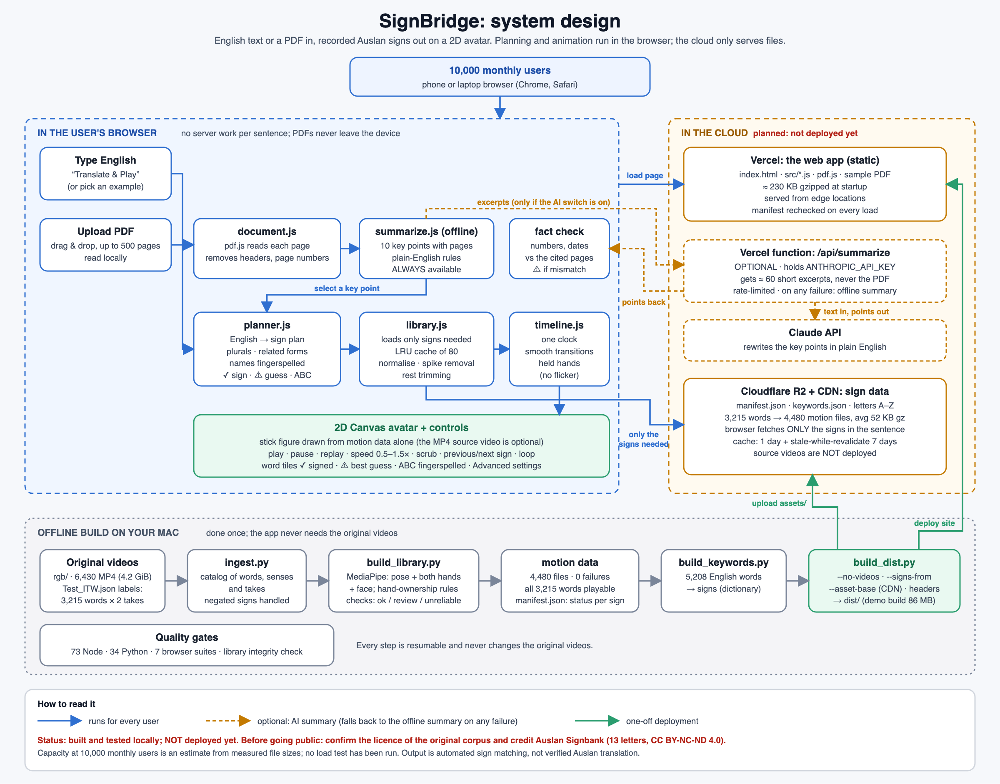

# Project structure



(Editable vector version: [system_design.svg](images/system_design.svg).)

Four rules keep this layout clean:

1. **The browser only loads `frontend/` and `assets/`.** Nothing under
   `datasets/` is ever served.
2. **Scripts never build paths from their own location.** Every path comes
   from [`backend/paths.py`](../backend/paths.py), so moving a folder means
   changing one line.
3. **Raw data is read-only.** `datasets/raw/` and the linked `datasets/videos/`
   and `datasets/landmarks/` are only read. Everything derived goes to
   `datasets/processed/` (build side) or `assets/` (what the app loads).
4. **Generated files are not in Git** (see `.gitignore`): they are rebuilt by
   one command each.

```
auslan-ai-clean/
├── README.md, requirements.txt, .env.example, .gitignore
│
├── frontend/                  THE WEB APP (static; this is what gets deployed)
│   ├── index.html             page, styles, rendering, playback, PDF flow
│   ├── src/
│   │   ├── planner.js         English -> sign plan (rules, every step explained)
│   │   ├── library.js         manifest lookup, lazy loading, cache, normalising, spike removal
│   │   ├── timeline.js        many clips -> one timeline, transitions, held hands
│   │   ├── document.js        PDF -> pages of text (pdf.js, in the browser)
│   │   └── summarize.js       offline key-point summary + fact check
│   ├── vendor/pdfjs/          pdf.js 3.11.174 (Mozilla, Apache-2.0)
│   └── samples/               sample_handbook.pdf for the demo button
│
├── assets/                    WHAT THE APP FETCHES AT RUNTIME
│   ├── signs/
│   │   ├── manifest.json      3,215 signs: clip id, status, search keys   (in Git)
│   │   ├── keywords.json      English word -> signs, from the dictionary   (in Git)
│   │   ├── face_topology.json face outline / eyes / lips edges             (in Git)
│   │   ├── motion/            4,480 motion files, one per extracted video  (not in Git)
│   │   └── videos/            web copies of the source videos              (not in Git)
│   ├── fingerspelling/        letters A-Z + 3 phrases: letters.json (Git), motion/ videos/ (not in Git)
│   └── signs.json             quick-pick buttons                           (in Git)
│
├── backend/                   PYTHON MODULES
│   ├── paths.py               every path, in one place
│   ├── extract_motion.py      MediaPipe extractor (video -> landmarks)
│   ├── serve.py               dev server (HTTP Range support), port 8003
│   ├── summarize_llm.py       optional AI summary logic;  api_summarize.py = Vercel function wrapper
│   └── llm_plan.py            optional: Claude-proposed gloss plans, validated against the library
│
├── scripts/                   COMMANDS (see the README table)
│   ├── ingest.py, build_library.py, validate_signs.py, build_keywords.py, finish_library.sh
│   ├── add_sign.py, qa_overlay.py, face_topology.py
│   ├── build_fingerspell.py, build_sentence.py, fetch_signbank_letter.py
│   ├── check_library.py, matching_report.mjs, collect_sign_ids.mjs
│   ├── build_dist.py          builds dist/ (the deployable folder)
│   └── core_words.txt, web_demo.txt   word lists (extraction order; web demo contents)
│
├── tests/                     run everything with:  sh tests/run_all.sh 8003
│   ├── test_*.mjs             Node: planner, matching, library, timeline, playback, documents
│   ├── test_*.py              Python: pipeline, AI-summary endpoint, LLM plan validation
│   ├── browser/               headless-Chrome suites (cdp.py is the tiny driver)
│   └── fixtures/              test PDFs (make_pdfs.py) and the old PAY regression data
│
├── datasets/
│   ├── raw/                   labels (Test_*.json), Dictionary_Mapping.pt, spreadsheets
│   ├── videos/rgb             LINK -> ../../rgb (6,430 original videos, never copied)
│   ├── landmarks/             LINKS -> dataset pose files (unused by the app)
│   └── processed/             catalog.json, extract_log.jsonl (resume point), validation.json,
│                              final_status.txt, fingerspell_letters/ (letter source clips)
│
├── docs/                      HOW_IT_WORKS, PIPELINE, DEPLOY, DATASET_REPORT, CODE_FAIR_REPORT,
│                              MATCHING_AND_UI, ANIMATION_DEBUG_REPORT, REVIEW_SAMPLE,
│                              MVP_CHECKLIST, WORKSPACE_MAP, images/
│
└── dist/                      GENERATED by scripts/build_dist.py (not in Git)
```

## Archived (outside the project)

On 2026-10-27 the experiments (2D renderers, 3D/Blender work; 442 MB) were
removed from the project after checking that every one of their 250 files has
a byte-identical copy in the original workspace (`../`). The old batch logs
and four superseded status documents are in `~/SignBridge-archive-2026-10-27/`
(9 MB); the documents are also in Git history (tag `pre-cleanup-2026-10-27`).
Also removed: the 1,265 web videos of second takes that no sign plays (243 MB;
regenerable from `rgb/` with ffmpeg). Their motion files were kept.

## The linked datasets

`datasets/videos/rgb` and the files under `datasets/landmarks/` are
relative symlinks to the original workspace, so 5.5 GB is not duplicated.
They resolve as long as `auslan-ai-clean/` stays inside the original folder.
If you move the project, re-point them, for example:

```sh
ln -sfn "/new/place/rgb" datasets/videos/rgb
```

Nothing else needs changing: every script finds the data through
`backend/paths.py`.
